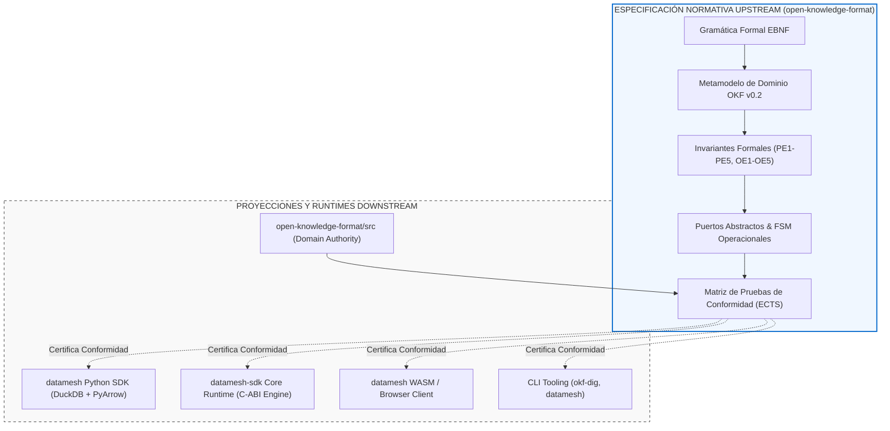
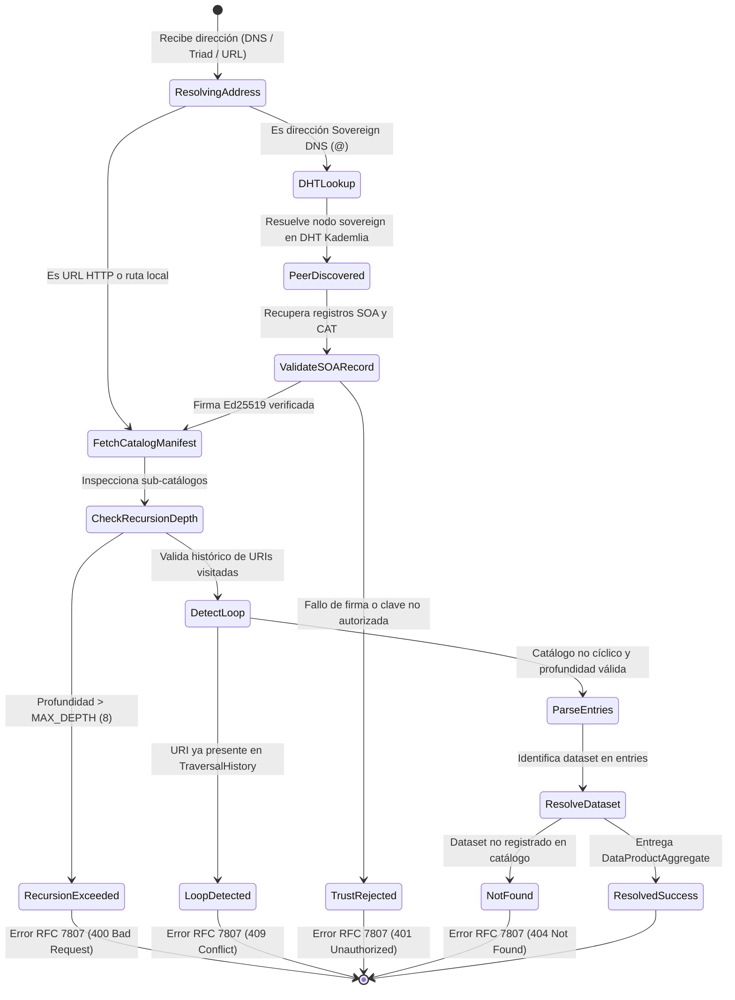
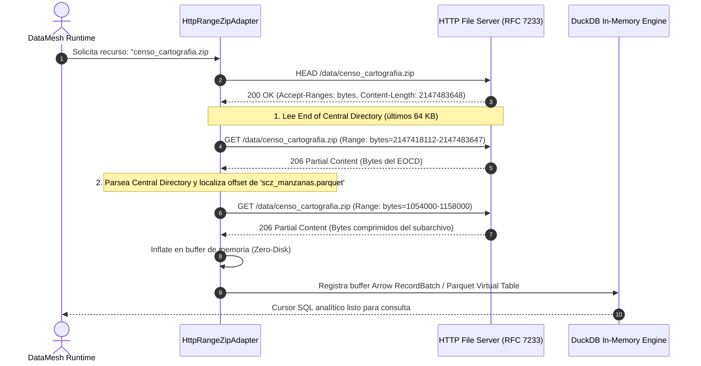

# Especificación Normativa de Diseño Guiado por Especificación (Specification-Driven Design - SDD)
## Formato de Conocimiento Abierto Federado Orientado a Datos (OKF/ODKF v0.2)
### Marco Formal para Ecosistemas de Datos Descentralizados, Legibilidad Tripartita y Contratos Ejecutables

> **Proyecto de Grado:** "Diseño e Implementación del Formato de Conocimiento Abierto Orientado a Datos"  
> **Carrera:** Ingeniería de Sistemas — Universidad de Aquino Bolivia (UDABOL)  
> **Postulante:** Andres Humberto Chirinos Lizondo  
> **Nivel de Madurez:** Estándar Normativo Candidato (Candidate Recommendation - CR)  
> **Repositorio Normativo:** [`open-knowledge-format`](file:///home/andreschirinos/Proyectos/open-knowledge-format)  
> **Runtime de Referencia:** [`datamesh-sdk`](file:///home/andreschirinos/Proyectos/datamesh-sdk)

---

## 1. Fundamentos y Filosofía del Specification-Driven Design (SDD)

El **Diseño Guiado por Especificación (Specification-Driven Design - SDD)** es la disciplina metodológica en la cual la especificación formal —compuesta por gramáticas formales, modelos algebraicos de tipos, axiomas, pre/post-condiciones e invariantes de estado— constituye la **única fuente de verdad normativa (Single Source of Truth)** del sistema. Los artefactos de software, bibliotecas de enlace, clientes de línea de comandos (CLI) y motores de consulta no son el estándar en sí mismos, sino **proyecciones verificables e intercambiables** que implementan la especificación.



### 1.1 Axioma de Verificación e Invarianza de Implementación
> **Axioma 1 (Complitud Contractual):** Ninguna implementación downstream está autorizada a introducir comportamientos observables, transformaciones sintácticas o suposiciones de transporte que no hayan sido formalmente estipuladas en la presente especificación. Toda discrepancia entre el código ejecutable y esta especificación constituye un fallo crítico del runtime ejecutable, no una ambigüedad del formato.

---

## 2. Gramática Formal Unificada de Direccionamiento (EBNF)

El acceso a catálogos, productos de datos y recursos en el ecosistema OKF se rige bajo una gramática libre de contexto expresada en notación **Extended Backus-Naur Form (EBNF)** (ISO/IEC 14977).

```ebnf
(* ========================================================================= *)
(* GRAMÁTICA FORMAL DE DIRECCIONAMIENTO UNIVERSAL OKF v0.2                  *)
(* ========================================================================= *)

Address             = SovereignDNSAddress | CanonicalURI | TriadAddress ;

(* 1. Direccionamiento DNS Soberano (P2P Reverse-Lookup) *)
SovereignDNSAddress = ResourceId , "." , DatasetId , "@" , CatalogDomain , [ Fragment ] ;
CatalogDomain       = Label , { "." , Label } ;

(* 2. URI Canónica Estándar (RFC 3986) *)
CanonicalURI        = "okf://" , CatalogId , "/" , DatasetId , "/" , ResourceId , [ Fragment ] ;

(* 3. Tríada Canónica de Dominio *)
TriadAddress        = [ CatalogId , ":" ] , DatasetId , ":" , ResourceId , [ Fragment ] ;

(* Componentes Léxicos y Nombres *)
CatalogId           = Identifier ;
DatasetId           = Identifier ;
ResourceId          = Identifier ;
Label               = LetterOrDigit , { LetterOrDigit | "-" } ;
Identifier          = ( Letter | "_" ) , { Letter | Digit | "_" | "-" } ;

(* 4. Fragment Identifiers para Archivos Compuestos (RFC 3986 §3.5) *)
Fragment            = "#" , SubPath ;
SubPath             = RelativeFilePath ;
RelativeFilePath    = PathSegment , { "/" , PathSegment } ;
PathSegment         = { Letter | Digit | "_" | "-" | "." } ;

(* Caracteres Base *)
Letter              = "a" ... "z" | "A" ... "Z" ;
Digit               = "0" ... "9" ;
LetterOrDigit       = Letter | Digit ;
```

### 2.1 Ejemplos Válidos e Invariantes Semánticas de Direccionamiento
1. **DNS Soberano:** `pm25_horario.calidad_aire@la_paz_alcaldia`
2. **DNS Soberano con Fragment Identifier ZIP:** `manzanas_scz.cartografia_2024@ine_bolivia#scz_manzanas.parquet`
3. **URI Canónica:** `okf://udabol_investigacion/epidemiologia/dengue_2024`
4. **Tríada Canónica:** `cndc:despacho_electrico:telemetria_stream`

---

## 3. Metamodelo de Entidades y Tipos Algebraicos

El dominio de conocimiento abierto se formaliza mediante tipos algebraicos inmutables y estructuras de datos estrictamente tipadas.

```mermaid
classDiagram
    class CatalogAggregate {
        +CatalogId id
        +string title
        +URI homepage
        +Publisher publisher
        +List~CatalogRecord~ records
        +List~CatalogRef~ federatedCatalogs
        +TrustTier trustTier
        +validate() bool
    }

    class CatalogRecord {
        +URI recordId
        +DatasetRef primaryTopic
        +DateTime issued
        +DateTime modified
        +List~URI~ sameAs
        +CID contentIdentifier
        +CatalogRole role
    }

    class DataProductAggregate {
        +DatasetId id
        +string title
        +SemVer version
        +LicenseIdentifier license
        +SpatialCoverage spatial
        +TemporalCoverage temporal
        +LineageProvenance provenance
        +List~ResourceEntity~ resources
        +PolicyContract policy
    }

    class ResourceEntity {
        <<Abstract>>
        +ResourceId name
        +FormatType format
        +MimeType mediaType
        +HashDigest sha256
    }

    class StaticDistribution {
        +URI path
        +int byteSize
        +TableSchema schema
        +OntologyMapping concepts
    }

    class DynamicDataService {
        +URI endpointURL
        +ServiceProtocol protocol
        +int refreshIntervalSeconds
        +CachePolicy cachePolicy
        +URI fallbackSnapshotPath
    }

    class CompositeArchive {
        +URI archivePath
        +ArchiveFormat packageFormat
        +bool supportsHttpRange
        +List~SubResource~ internalResources
    }

    CatalogAggregate *-- CatalogRecord
    CatalogRecord --> DataProductAggregate : foaf:primaryTopic
    DataProductAggregate *-- ResourceEntity
    ResourceEntity <|-- StaticDistribution
    ResourceEntity <|-- DynamicDataService
    ResourceEntity <|-- CompositeArchive
```

### 3.1 Definición de Tipos Normativos (TypeScript / Interface Schema)

```typescript
export type HashSHA256 = `sha256:${string}`;
export type CID = string; // Content Identifier multihash

export interface SpatialCoverage {
  readonly country: "BO" | string;
  readonly regions?: readonly string[]; // ISO 3166-2 e.g. ["BO-L", "BO-S"]
  readonly bbox?: readonly [number, number, number, number]; // [min_lon, min_lat, max_lon, max_lat]
}

export interface TemporalCoverage {
  readonly start: string; // ISO 8601
  readonly end?: string;
  readonly frequency?: "hourly" | "daily" | "weekly" | "monthly" | "realtime";
}

export interface LineageProvenance {
  readonly wasGeneratedBy?: string; // URI of Activity / Pipeline
  readonly wasAttributedTo: string; // URI or URN of Sovereign Agent / Institution
  readonly generatedAt?: string;
  readonly sources?: readonly string[];
}

export interface DynamicDataService {
  readonly type: "dcat:DataService";
  readonly name: string;
  readonly endpointURL: string;
  readonly protocol: "flight-sql" | "openapi" | "websocket" | "duckdb-stream";
  readonly refreshIntervalSeconds?: number;
  readonly cachePolicy: {
    readonly ttlSeconds: number;
    readonly strategy: "sliding_window" | "snapshot_on_failure";
  };
  readonly fallbackSnapshotPath?: string;
}

export interface CompositeArchiveResource {
  readonly name: string;
  readonly path: string;
  readonly format: "zip" | "tar" | "tar.gz";
  readonly packageFormat: "application/zip" | "application/x-tar";
  readonly supportsHttpRange: boolean;
  readonly internalResources: readonly {
    readonly name: string;
    readonly subpath: string;
    readonly format: "parquet" | "csv" | "json";
    readonly uriFragment: string; // e.g. "archive.zip#subpath.parquet"
  }[];
}
```

---

## 4. Semántica Operacional y Máquinas de Estados Finitos (FSM)

El comportamiento de los componentes se rige por especificaciones formales de transición de estados que garantizan determinismo y tolerancia a particiones de red.

### 4.1 FSM 1: Resolución y Travesía Recursiva de Catálogos



### 4.2 FSM 2: Extracción Selectiva Zero-Copy mediante HTTP Range Requests (RFC 7233)



---

## 5. Especificación Formal de Contratos de Puertos Abstractos

Conforme a los principios de Arquitectura Hexagonal, se definen los cinco puertos del núcleo normativo:

```text
+---------------------------------------------------------------------------------+
|                               PUERTOS NORMATIVOS                                |
+---------------------------------------------------------------------------------+
| 1. StoragePort: Acceso binario y lectura por rangos (RFC 7233)                  |
| 2. CatalogResolverPort: Descubrimiento y recorrido acotado de catálogos         |
| 3. DataProductResolverPort: Parseo agnóstico y validación de contratos          |
| 4. QueryEnginePort: Ejecución analítica cero-copia y pushdown de predicados     |
| 5. TrustVerifierPort: Criptografía soberana, Ed25519, OpenSSH y linaje PROV-O   |
+---------------------------------------------------------------------------------+
```

### 5.1 `StoragePort`
- **`read(uri: URI) -> Stream[bytes]`**
  - *Precondición:* `uri` accesible y esquema permitido (`file://`, `http://`, `https://`, `s3://`).
  - *Postcondición:* Retorna stream binario completo o lanza `ResourceNotFoundError`.
- **`range_read(uri: URI, offset: uint64, length: uint32) -> bytes`**
  - *Precondición:* El servidor remoto anuncia cabecera `Accept-Ranges: bytes`.
  - *Invariante:* Longitud del buffer devuelto $\equiv length$. No se transfieren bytes fuera del intervalo $[offset, offset + length - 1]$.

### 5.2 `CatalogResolverPort`
- **`resolve(reference: CatalogAddress) -> CatalogAggregate`**
  - *Invariante de Recursión:* Profundidad acumulada $\le 8$.
  - *Invariante de Aciclicidad:* $CatalogURI 
otin TraversalHistory$. En caso de ciclo, aborta con `CyclicFederationError`.

### 5.3 `DataProductResolverPort`
- **`parse_manifest(payload: str | bytes) -> DataProductAggregate`**
  - *Precondición:* El documento contiene Frontmatter YAML delimitado por `---` o estructura JSON de Data Package.
  - *Postcondición:* Valida la presencia de invariantes de calidad y cobertura espacial/temporal.

### 5.4 `QueryEnginePort`
- **`execute_sql(query: SQLStatement, bindings: Map[Triad, PhysicalPath]) -> ArrowRecordBatchStream`**
  - *Invariante de Aislamiento:* La consulta no puede acceder al sistema de archivos local fuera del mapping explícito de tablas autorizadas.
  - *Invariante de Microdatos:* Si el dataset tiene `policy: zero_microdata`, cualquier consulta no agregada (`SELECT *`) es interceptada y rechazada con `PolicyViolationError`.

### 5.5 `TrustVerifierPort`
- **`verify_authorship(manifest: Manifest, proof: CryptographicProof) -> TrustVerdict`**
  - *Axioma:* Las firmas digitales deben evaluarse contra llaves públicas extraídas de listas blancas explícitas o de perfiles soberanos verificados (`https://github.com/<user>.keys`).

---

## 6. Matriz de Pruebas de Conformidad Ejecutable (Executable Conformance Test Suite - ECTS)

Para certificar que una biblioteca o motor es un **Runtime Válido OKF v0.2**, debe superar el 100% de la suite de pruebas ECTS:

| Identificador de Test | Escenario Normativo | Entrada / Vector de Prueba | Comportamiento Esperado | Criterio de Éxito |
| :--- | :--- | :--- | :--- | :--- |
| **ECTS-01** | Resolución de Tríada Canónica | `catalogo:dataset:resource` | Resuelve ruta física o stream sin ambigüedad | Objeto `DataProduct` con esquema válido |
| **ECTS-02** | Detección de Recursión Cíclica | Catálogo A $	o$ Catálogo B $	o$ Catálogo A | Intercepta ciclo en el segundo salto | Lanza `CyclicFederationError` controlado |
| **ECTS-03** | Límite Máximo de Profundidad | Cadena de catálogos de 9 niveles | Corta resolución en nivel 8 | Lanza `MaxCatalogDepthExceededError` |
| **ECTS-04** | Extracción Parcial de ZIP | Petición con fragment `#table.parquet` | Emite HTTP Range Request selectivo | Descarga únicamente EOCD y subarchivo |
| **ECTS-05** | Fallback Offline en DataService | Corte de conexión gRPC Flight SQL | Conmuta a snapshot Parquet local | Consulta retorna datos desde snapshot con warning |
| **ECTS-06** | Cumplimiento Zero-Microdata | `SELECT * FROM censo` con política restrictiva | Analiza AST de consulta SQL | Bloquea ejecución con `PolicyViolationError` |
| **ECTS-07** | Verificación de Autoría OpenSSH | Firma Ed25519 cotejada contra GitHub DID | Valida wire format RFC 4253 | Confirma veredicto de autenticidad `machine-confirmed` |

---

## 7. Articulación con la Metodología DSRM y Tesis de Grado (UDABOL)

Este diseño guiado por especificación fundamenta directamente la propuesta de grado:

1. **Marco Metodológico (Capítulo III):**
   - El SDD representa el puente formal entre el **Ciclo de Rigor** (fundamentación en estándares W3C, RFCs y literatura) y el **Ciclo de Diseño** (construcción de artefactos DSRM).
2. **Ingeniería del Software (Capítulo IV):**
   - *Sección IV.1:* La presente especificación formal (gramáticas, tipos, FSM y puertos) conforma el cuerpo técnico de la estandarización.
   - *Sección IV.2:* Los adaptadores y el motor de ejecución DuckDB/Arrow de `datamesh-sdk` demuestran la instanciación de los puertos.
3. **Evaluación Experimental y Validación (Capítulo V):**
   - La suite ECTS provee los criterios cuantitativos e inmutables para verificar empíricamente que la solución resuelve las problemáticas FAIR de datos en Bolivia.
