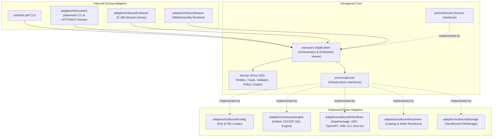

# Open Knowledge Format (OKF / ODKF v0.2) Go Core Engine (`src`)

## Overview & Architectural Role

`src` is the Hexagonal Architecture / Domain-Driven Design (DDD) Go module root ([`go.mod`](./go.mod): `module github.com/datosbolivia/open-knowledge-format/src`, Go `1.22`) for the Open Knowledge Format (OKF / ODKF v0.2) specification engine and DataMesh runtime (`v0.3.0-dev.1`).



## Subtree Index

| Subtree | Classification | Role & Contract Summary |
| :--- | :--- | :--- |
| [`domain/`](./domain/README.md) | Component Package (Peanut) | Pure DDD core entities (`DataProduct`, `Manifest`, `PackageManifest`), 5-form `ResourceTriad` addressing (`okf://`, Sovereign DNS `<dataset>.<resource>@<catalog>`, `#fragment`), conformance validator (`PE1`–`PE5`, `RULE-01`–`RULE-12`), access governance (`allow_all`, `zero_microdata`, $k$-anonymity), Ed25519/SHA-256/`did:github` crypto, W3C PROV-O lineage DAG, Frictionless/DCAT bridges, and fallback SQL parser. |
| [`ports/`](./ports/README.md) | Intermediate Blueprint (Hay) | Pure Go interface boundaries divided into [`ports/inbound`](./ports/inbound/README.md) (9 driving service ports) and [`ports/outbound`](./ports/outbound/README.md) (12 driven infrastructure ports). |
| [`usecases/`](./usecases/README.md) | Component Package (Peanut) | Application orchestration implementing `ports/inbound` plus OKF bundle lifecycle workflows (`InitBundle`, `AddConcept`, `LinkConcepts`, `GenerateIndex`, `AuditBundle`, `BuildGraphAdjacency`, `DiffBundles`, `AttestComputation`, `ExecuteScript`, `ValidateUseCase`, `VisualizeUseCase` with embedded [`usecases/assets`](./usecases/assets/README.md)). |
| [`adapters/`](./adapters/README.md) | Intermediate Blueprint (Hay) | Driving adapters in [`adapters/inbound`](./adapters/inbound/README.md) ([`cli`](./adapters/inbound/cli/README.md), [`cshared`](./adapters/inbound/cshared/README.md), [`wasm`](./adapters/inbound/wasm/README.md)) and driven adapters in [`adapters/outbound`](./adapters/outbound/README.md) ([`config`](./adapters/outbound/config/README.md), [`engine`](./adapters/outbound/engine/README.md), [`manifests`](./adapters/outbound/manifests/README.md), [`resolvers`](./adapters/outbound/resolvers/README.md), [`storage`](./adapters/outbound/storage/README.md)). |
| [`cmd/`](./cmd/README.md) | Intermediate Blueprint (Hay) | Standalone `okf` CLI binary entrypoint in [`cmd/okf`](./cmd/okf/README.md). |

## Interface

- **Module Manifest ([`go.mod`](./go.mod))**:
  - Module path: `github.com/datosbolivia/open-knowledge-format/src`
  - External dependency: `gopkg.in/yaml.v3 v3.0.1`
- **Executable & Library Targets**:
  - [`./cmd/okf/README.md`](./cmd/okf/README.md): `go build -o ../bin/okf ./cmd/okf`
  - [`./adapters/inbound/cli/README.md`](./adapters/inbound/cli/README.md): `go build -o ../bin/datamesh ./adapters/inbound/cli`
  - [`./adapters/inbound/cshared/README.md`](./adapters/inbound/cshared/README.md): `go build -buildmode=c-shared -o libdatamesh.so ./adapters/inbound/cshared`
  - [`./adapters/inbound/wasm/README.md`](./adapters/inbound/wasm/README.md): `GOOS=js GOARCH=wasm go build -o datamesh.wasm ./adapters/inbound/wasm`

## Invariants

1. **Strict Hexagonal Dependency Direction**: [`./domain/README.md`](./domain/README.md) has zero internal imports; [`./ports/README.md`](./ports/README.md) imports only `context` and `domain`; [`./usecases/README.md`](./usecases/README.md) imports only `domain` and `ports`; [`./adapters/outbound/README.md`](./adapters/outbound/README.md) imports only `domain` and `ports/outbound`.
2. **Deterministic Conformance & Governance**: Validation (`ValidateConceptContent`, `ValidateBundle`, `ValidateTriad`), SemVer diffing (`DiffBundles`), attestation (`AttestComputation`), policy evaluation (`EvaluateQueryWithProfile`), and SKOS SQL generation (`GenerateCrossDatasetJoinSQL`) produce deterministic outputs for identical inputs.
3. **SSRF & Traversal Confinement**: HTTP/MCP adapters enforce `validateOutboundURL` and `isForbiddenLocalRef`; `FileStorage` confines paths to `baseDir` via `resolveSafePath`.

## Side Effects

- Delegates CLI I/O, HTTP server binding, outbound HTTP requests, C-heap allocations, WASM global registration, subprocess script execution, and local filesystem reads/writes through [`./cmd/README.md`](./cmd/README.md), [`./usecases/README.md`](./usecases/README.md), and [`./adapters/README.md`](./adapters/README.md).

## Verification

```bash
cd src && go test ./...
```
