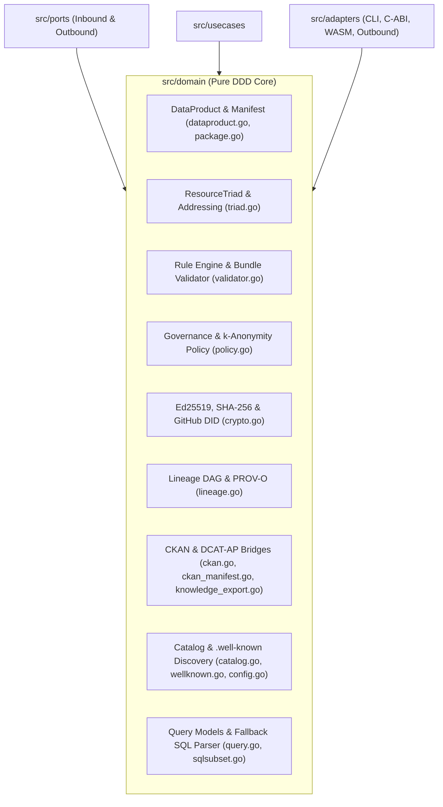

# Package `domain` — Open Knowledge Format (OKF / ODKF v0.2) Core Domain Model (`src/domain`)

## Overview & Role

Pure Domain-Driven Design (DDD) core package (`github.com/datosbolivia/open-knowledge-format/src/domain`) implementing the normative entities, aggregate roots, value objects, addressing grammars, cryptographic primitives, access governance policies, and conformance validation rules for the Open Knowledge Format (OKF / ODKF v0.2).

- **Layer**: Innermost Hexagonal Domain Core (`src/domain`).
- **Inbound Dependents**: Consumed by [`src/ports/inbound`](../ports/inbound/README.md), [`src/ports/outbound`](../ports/outbound/README.md), [`src/usecases`](../usecases/README.md), and [`src/adapters`](../adapters/README.md).
- **Outbound Dependencies**: Zero internal project imports. Depends exclusively on the Go standard library and `gopkg.in/yaml.v3`.



## Interface

### 1. Data Product Aggregate & Semantic Manifest ([`dataproduct.go`](./dataproduct.go), [`package.go`](./package.go))
- **`[dataproduct.go:NewDataProduct]`**: `NewDataProduct(id string, manifest Manifest, description string, resources []Resource) (*DataProduct, error)` — Instantiates and validates a `DataProduct` aggregate root.
- **`[dataproduct.go:DataProduct.Validate]`**: `(*DataProduct).Validate() error` — Enforces non-empty `Manifest.Title` (`[dataproduct.go:ErrEmptyTitle]`) and `Manifest.Type` (`[dataproduct.go:ErrInvalidType]`, `[dataproduct.go:ErrMissingDimension]`).
- **`[dataproduct.go:ConformanceProfile]`**: Modular conformance profiles `ProfileLevel0Core` (`level-0-core`), `ProfileLevel1Contracts` (`level-1-contracts`), and `ProfileLevel2Sovereign` (`level-2-sovereign`).
- **Core Manifest & Epistemic Types (`[dataproduct.go:Manifest]`, `[dataproduct.go:Resource]`)**: `[dataproduct.go:Contract]`, `[dataproduct.go:CLIInputParam]`, `[dataproduct.go:CLIOutputSpec]`, `[dataproduct.go:ResourceField]`, `[dataproduct.go:GeneratedSpec]`, `[dataproduct.go:VerificationRecord]`, `[dataproduct.go:FreshnessSpec]`, `[dataproduct.go:EpistemicActor]`, `[dataproduct.go:Lineage]`, `[dataproduct.go:SpatialCoverage]`, `[dataproduct.go:TemporalCoverage]`, `[dataproduct.go:QualityProfile]`, `[dataproduct.go:QualityCheckRule]`, `[dataproduct.go:Signature]`, `[dataproduct.go:AttestationVerdict]`, `[dataproduct.go:PublicationTargetResult]`.
- **`[dataproduct.go:ConceptNodeSKOS]`**, **`[dataproduct.go:ValueLabelConceptEntry]`**, **`[dataproduct.go:ConceptCorrespondence]`**, **`[dataproduct.go:SemanticFieldMapping]`**: Semantic `ValueLabel -> Concept -> SKOS` correspondence models.
- **`[package.go:PackageManifest]`**, **`[package.go:PackageFormat]`**, **`[package.go:Slugify]`** & **`[package.go:PackageManifest.FindResource]`**: Normalized package container (`PackageFormatDataPackageJSON`, `PackageFormatDataPackageYAML`, `PackageFormatOKFMarkdown`, `PackageFormatLLMSTxt`, `PackageFormatCustom`), ASCII slug normalization, and fuzzy resource lookup.

### 2. Universal Resource Addressing ([`triad.go`](./triad.go))
- **`[triad.go:ParseTriad]`** & **`[triad.go:NormalizeTriadSegment]`** (`[triad.go:ErrInvalidTriadFormat]`): Parses canonical triads (`[catalog:]dataset:resource[#fragment]`), `okf://` / `datamesh://` / `odkf://` URIs, Sovereign DNS (`<dataset>.<resource>@<catalog>[#fragment]`), HTTP/HTTPS/file URLs, and slash-separated paths into a normalized `ResourceTriad` (`[triad.go:ResolvedResource]`).
- **`[triad.go:ResourceTriad.String]`**, **`[triad.go:ResourceTriad.FullURI]`**, **`[triad.go:ResourceTriad.OKFURI]`**, **`[triad.go:ResourceTriad.SovereignDNS]`**: Projects a triad into canonical colon format, `datamesh://`, `okf://`, or `<dataset>.<resource>@<catalog>` format while preserving RFC 3986 `#fragment` identifiers.
- **`[triad.go:ExtractTriadsFromSQL]`**: Scans `FROM`/`JOIN` clauses and quoted string literals in SQL statements to extract deduplicated `ResourceTriad` references.

### 3. Conformance Validation Engine ([`validator.go`](./validator.go))
- **`[validator.go:StringList.UnmarshalYAML]`** & **`[validator.go:VerificationList.UnmarshalYAML]`**: Custom YAML unmarshalers for `[validator.go:ConceptFrontmatter]` (`[validator.go:ContractSpec]`, `[validator.go:LineageSpec]`, `[validator.go:TransformationSpec]`, `[validator.go:RelationSpec]`) supporting YAML sequences, scalars, and mapping nodes (`skos: {prefLabel: ...}`).
- **`[validator.go:ValidateConceptContent]`**, **`[validator.go:ValidateBundle]`**, **`[validator.go:ValidateTriad]`**: Validate Markdown concepts, bundle directories, and triad syntax, returning `*ValidationReport` (`[validator.go:ValidationReport]`, `[validator.go:ValidationReport.AddIssue]`, `[validator.go:ValidationReport.ToJSON]`, `[validator.go:ValidationIssue]`, `[validator.go:Severity]`).

### 4. Access Governance & Privacy Enforcement ([`policy.go`](./policy.go))
- **`[policy.go:ParseGranularPolicy]`** (`[policy.go:GranularPolicy]`, `[policy.go:PolicyRule]`, `[policy.go:PolicyType]`, `[policy.go:Permission]`, `[policy.go:ErrPolicyViolation]`): Parses JSON policy definitions or expands built-in profile shorthands (`allow_all`, `zero_microdata`, `deny`), supporting external policy standards (`PolicySpec` for ODRL, OPA/Rego, DPV, XACML).
- **`[policy.go:ComputeEffectivePolicy]`** (`[policy.go:UserIdentity]`, `[policy.go:EffectivePolicyProfile]`): Evaluates rules matching caller `Role` (`public`, `analyst`, `auditor`, `admin`) and `TrustTier` (`unverified`, `machine-confirmed`, `human-reviewed`, `official`).
- **`[policy.go:EvaluateQueryWithProfile]`** & **`[policy.go:EvaluateQueryAccess]`** (`[policy.go:PolicyDecision]`): Enforces column-level PII/hidden restrictions (`HiddenColumns`, `PIIColumns`), `zero_microdata` aggregation-only constraints (`ClassifyQueryIntent`), and $k$-anonymity minimum group size (`MinGroupSize` via `HAVING COUNT(*) >= k`).

### 5. Cryptographic Provenance & Identity ([`crypto.go`](./crypto.go))
- **`[crypto.go:ComputeSHA256]`** & **`[crypto.go:VerifySHA256]`**: Computes and verifies hex SHA-256 digests (tolerating optional `sha256:` prefixes).
- **`[crypto.go:VerifyEd25519Signature]`** (`[crypto.go:ErrInvalidHexKey]`, `[crypto.go:ErrInvalidHexSignature]`, `[crypto.go:ErrInvalidKeyLength]`, `[crypto.go:ErrInvalidSigLength]`): Validates 64-byte Ed25519 signatures against 32-byte hex public keys.
- **`[crypto.go:ParseOpenSSHEd25519PublicKey]`**: Parses RFC 4253 `ssh-ed25519` wire-format public keys into raw bytes and lowercase hex.
- **`[crypto.go:VerifyGitHubDID]`** & **`[crypto.go:MatchesGitHubSSHKey]`**: Validates `did:github:<username>` syntax and matches `claimedPubKey` against the user's `ssh-ed25519` keys.

### 6. Lineage Graph, Interoperability & Fallback SQL ([`lineage.go`](./lineage.go), [`ckan.go`](./ckan.go), [`ckan_manifest.go`](./ckan_manifest.go), [`knowledge_export.go`](./knowledge_export.go), [`sqlsubset.go`](./sqlsubset.go), [`catalog.go`](./catalog.go), [`wellknown.go`](./wellknown.go), [`config.go`](./config.go), [`query.go`](./query.go))
- **`[lineage.go:NewLineageGraph]`**, **`[lineage.go:LineageGraph.Upstream]`**, **`[lineage.go:LineageGraph.Downstream]`**, **`[lineage.go:LineageGraph.ToMermaid]`**, **`[lineage.go:LineageGraph.ToASCII]`** (`[lineage.go:LineageInfo]`, `[lineage.go:LineageSource]`, `[lineage.go:LineageTransformation]`, `[lineage.go:LineageNode]`, `[lineage.go:LineageEdge]`): Breadth-first DAG traversal and visualization of dataset provenance.
- **`[ckan_manifest.go:ReconstructManifestFromCKAN]`** (`[ckan.go:CKANPackage]`, `[ckan.go:CKANResource]`, `[ckan.go:CKANDataStoreField]`, `[ckan.go:CKANExtra]`, `[ckan.go:CKANOrganization]`, `[ckan.go:CKANGroup]`, `[ckan.go:CKANTag]`, `[ckan.go:CKANHarvestResult]`): Elevates CKAN Action API v3 packages into ODKF `PackageManifest` objects.
- **`[knowledge_export.go:DataProduct.ToCKANDataPackageJSON]`** & **`[knowledge_export.go:DataProduct.ToDCATJSON]`** (`[knowledge_export.go:CKANDataPackageJSON]`, `[knowledge_export.go:FrictionlessResource]`, `[knowledge_export.go:DCATDatasetJSON]`, `[knowledge_export.go:DCATDistribution]`, `[knowledge_export.go:DCATContext]`, `[knowledge_export.go:CKANDataPackageProfile]`): Serializes a `DataProduct` into Frictionless DataPackage JSON or W3C DCAT-AP JSON-LD (`https://www.w3.org/ns/dcat.jsonld`).
- **`[sqlsubset.go:ParseSimpleSelect]`** (`[sqlsubset.go:SimpleSelect]`): Conservative pure-Go SQL parser for single-table projections, equality `WHERE` filters, and `LIMIT` clauses.
- **`[catalog.go:Catalog.FindByKeyword]`** & **`[catalog.go:Catalog.FindByDomain]`** (`[catalog.go:CatalogEntry]`): Diacritic-insensitive multi-token search across catalog entries (`[wellknown.go:WellKnownDiscovery]`, `[wellknown.go:CatalogMetadata]`, `[wellknown.go:AuthConfiguration]`, `[wellknown.go:KeycloakAuth]`, `[wellknown.go:OAuth2Auth]`, `[wellknown.go:APIKeyAuth]`).
- **`[config.go:NewDefaultConfig]`**, **`[config.go:Config.Validate]`**, **`[config.go:Config.Sanitized]`**, **`[config.go:Config.GetAdapterValue]`** (`[config.go:BaseConfig]`, `[config.go:ErrInvalidCatalogURL]`, `[config.go:ErrInvalidTimeout]`): Initializes default configuration (`https://datosbolivia.github.io/llms.txt`), validates invariants, and masks sensitive adapter keys with `"***"`.
- **`[query.go:NewQueryResult]`** (`[query.go:QueryRequest]`, `[query.go:TableBinding]`, `[query.go:QueryOptions]`, `[query.go:SQLQueryRequest]`, `[query.go:QueryResult]`): Tabular and SQL query value objects.

## Invariants

1. **Open Type Taxonomy (`[validator.go:ValidateConceptContent]`, `PE2-TYPE-REQUIRED`)**: Every concept frontmatter and `DataProduct` must declare a non-empty `type`, and `DataProduct` requires a non-empty `title`. Unknown `type` values are never rejected.
2. **YAML Frontmatter Delimiters (`PE1-SYNTAX`, `RULE-01-YAML`)**: Concept Markdown documents must start with `---` on line 1, close with `---`, and contain valid YAML.
3. **Dual-Graph Cycle Detection (`[validator.go:ValidateBundle]`)**:
   - **Strict Acyclic DAG (`RULE-12-DAG-CYCLE`, `SeverityError`)**: Frontmatter relations (`supersedes`, `superseded_by`, `derived_from`, `in_catalog`, `dcat:incatalog`) must form a strict Directed Acyclic Graph.
   - **Navigational Links (`RULE-12-CIRCULAR-REFERENCE`, `SeverityWarning`)**: Cycles in Markdown body links (`[...](target.md)`) emit warnings rather than errors.
4. **Zero-Microdata & $k$-Anonymity Governance (`[policy.go:EvaluateQueryWithProfile]`)**: Unprivileged callers querying a `zero_microdata` dataset are blocked from raw row queries; when `MinGroupSize > 1` and `GROUP BY` is present, the query must include `HAVING COUNT(...) >= k` ($k \ge \text{MinGroupSize}$); queries referencing `HiddenColumns` or `PIIColumns` are rejected with `PolicyDeny`.

## Side Effects

- **Read-Only Local Filesystem Verification (`[validator.go:ValidateConceptContent]`, `[validator.go:ValidateBundle]`)**: Performs read-only `os.Stat`, `os.ReadFile`, and `filepath.Walk` operations when a non-empty `filePath` or `bundleDir` is provided to verify referenced local contracts, policy files, and tool SHA-256 digests (`PE5-HASH-MISMATCH`). All other functions in `src/domain` are pure in-memory transformations.

## Verification

```bash
cd src && go test -v ./domain/...
```
