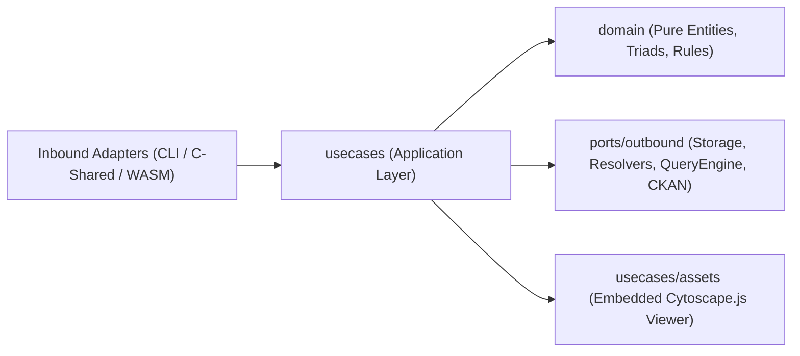

# `usecases` Package — Application Orchestration & Inbound Port Implementations (`src/usecases`)

## Overview & Role

Application-layer use cases for the Open Knowledge Format (OKF/ODKF v0.2) Go core engine (`github.com/datosbolivia/open-knowledge-format/src/usecases`). This package implements the hexagonal inbound service ports ([`src/ports/inbound`](../ports/inbound/README.md)), orchestrating domain entities ([`src/domain`](../domain/README.md)), outbound storage/catalog/query/CKAN adapters ([`src/ports/outbound`](../ports/outbound/README.md)), and local bundle lifecycle workflows (`init`, `add`, `link`, `index`, `audit`, `graph`, `run`, `diff`, `attest`, `validate`, `visualize`).



## Subtree Index

| Directory | Role & Contract Summary |
| :--- | :--- |
| [`assets/`](./assets/README.md) | Embedded HTML/CSS/JS templates (`viz.html`, `viz.css`, `viz.js`) used by `VisualizeUseCase` to generate self-contained interactive Cytoscape.js bundle viewers. |

## Interface

### 1. Bundle Authoring, Evolution & Lifecycle ([`init.go`](./init.go), [`add.go`](./add.go), [`link.go`](./link.go), [`index.go`](./index.go), [`diff_and_attest.go`](./diff_and_attest.go), [`bundle_helpers.go`](./bundle_helpers.go))

| Symbol (`[file:symbol]`) | Signature | Responsibility |
| :--- | :--- | :--- |
| `[init.go:InitBundle]` | `func InitBundle(targetDir string, bundleTitle string, description string) error` | Creates a conformant OKF v0.2 bundle directory containing root `index.md` (`generated.by: "agent:okf-cli"`), append-only `log.md`, `concepts/sample_dataset.md`, and `concepts/datapackage.json`. |
| `[add.go:AddConcept]` | `func AddConcept(params AddConceptParams) (string, error)` | Creates a new `.md` concept file with YAML frontmatter (`type`, `title`, `description`, `status: active`, `generated`, `freshness.cadence`) and appends an entry to `log.md`. |
| `[link.go:LinkConcepts]` | `func LinkConcepts(sourcePath, targetPath, relation string) error` | Computes relative path from `sourcePath` to `targetPath` and inserts `- [<relation>](<relPath>)` under `## Related Concepts` in `sourcePath`. Appends an entry to `log.md`. |
| `[index.go:GenerateIndex]` | `func GenerateIndex(bundleDir string) (*IndexReport, error)` | Walks `bundleDir` (skipping `index.md`, `log.md`, `README.md`), parses YAML frontmatter (`domain.ConceptFrontmatter`), sorts concepts by `(Type, Title)`, and writes a progressive-disclosure table to `<bundleDir>/index.md`. |
| `[diff_and_attest.go:DiffBundles]` | `func DiffBundles(oldPath, newPath string) (*DiffReport, error)` | Computes structural and semantic differences (`[diff_and_attest.go:DiffChange]`) between two bundle versions and recommends SemVer 2.0.0 bump (`[diff_and_attest.go:SemVerLevel]`: `SemVerNone`, `SemVerPatch`, `SemVerMinor`, `SemVerMajor`). |
| `[diff_and_attest.go:AttestComputation]` / `[diff_and_attest.go:NormalizeSQLCanonical]` | `func AttestComputation(conceptPath string, executedSQLOrReceipt string, params map[string]string) (*domain.AttestationVerdict, error)` | Verifies an Attested Computation concept receipt against `executedSQLOrReceipt` and query parameter bindings `params`, returning a deterministic `domain.AttestationVerdict` (`"verified"`, `"refuted"`, `"error"`). |

### 2. Validation, Auditing, Graph, Script Execution & Visualization ([`validate.go`](./validate.go), [`audit.go`](./audit.go), [`graph.go`](./graph.go), [`visualize.go`](./visualize.go), [`run.go`](./run.go))

| Symbol (`[file:symbol]`) | Signature | Responsibility |
| :--- | :--- | :--- |
| `[validate.go:NewValidateUseCase]` / `[validate.go:Validate]` | `Validate(ctx context.Context, target string) (*domain.ValidationReport, error)` | Dispatches validation across HTTP/HTTPS URLs, local directories (`domain.ValidateBundle`), local files (`domain.ValidateConceptContent`), and canonical triads (`domain.ValidateTriad`). |
| `[audit.go:AuditBundle]` | `func AuditBundle(bundleDir string) (*AuditReport, error)` | Scans `.md` files in `bundleDir` checking `BROKEN-LINK` (`ERROR`), `RULE-12-SELF-REF` (`WARNING`), `RULE-12-CIRCULAR-REF` (`WARNING`), `MISSING-FRONTMATTER` (`WARNING`), `ORPHAN-NODE` (`WARNING`), and `STALE-EXPIRED` (`WARNING`). |
| `[graph.go:BuildGraphAdjacency]` | `func BuildGraphAdjacency(bundleDir string) (*GraphAdjacencyReport, error)` | Extracts sorted `ConceptSummary` nodes and directed `GraphEdge` links (`Source`, `Target`, `Relation`) across a bundle. |
| `[visualize.go:VisualizeUseCase]` / `[visualize.go:NewVisualizeUseCase]` / `[visualize.go:VisualizeUseCase.Generate]` | `Generate(bundleRoot, outPath, bundleName string) (*VisualizeStats, error)` | Walks `bundleRoot`, derives trust tiers and staleness (`[visualize.go:ConceptNode]`, `[visualize.go:CytoscapeNode]`, `[visualize.go:CytoscapeEdge]`, `[visualize.go:CytoscapeEdgeData]`), builds a `GraphPayload`, and injects it into embedded [`assets/`](./assets/README.md) (`viz.html`, `viz.css`, `viz.js`). |
| `[run.go:ExecuteScript]` / `[run.go:ComputeFileSHA256]` | `func ExecuteScript(params RunParams) (*RunExecutionResult, error)` | Computes SHA-256 of `params.ScriptPath` (`[run.go:ComputeFileSHA256]`), executes `.py` via `python3`, `.sh` via `bash`, or binaries directly, captures stdout/stderr/exit code/duration, and appends provenance metadata to `log.md`. |

### 3. Federated Catalogs, Data Products, Queries & Lineage ([`config_usecase.go`](./config_usecase.go), [`discover_catalog.go`](./discover_catalog.go), [`resolve_dataproduct.go`](./resolve_dataproduct.go), [`query_dataproduct.go`](./query_dataproduct.go), [`lineage_usecase.go`](./lineage_usecase.go))

| Symbol (`[file:symbol]`) | Signature | Responsibility |
| :--- | :--- | :--- |
| `[config_usecase.go:ConfigUseCase]` / `[config_usecase.go:NewConfigUseCase]` | `GetConfig() domain.Config` | Loads and validates immutable runtime configuration via `outbound.ConfigLoaderPort`. |
| `[discover_catalog.go:DiscoverCatalogUseCase]` / `[discover_catalog.go:NewDiscoverCatalogUseCase]` | `DiscoverAll(ctx)` / `Discover(ctx, catalogURL)` / `Search(ctx, catalogURL, keyword)` | Implements `inbound.CatalogServicePort`. Concurrently fetches and deduplicates federated catalogs configured in `Base.CatalogURLs`. |
| `[resolve_dataproduct.go:ResolveDataProductUseCase]` / `[resolve_dataproduct.go:NewResolveDataProductUseCase]` / `[resolve_dataproduct.go:ErrInvalidDataProductURI]` | `Resolve(ctx, uriOrURL string)` / `Validate(ctx, dp *domain.DataProduct)` | Implements `inbound.DataProductServicePort`. Fetches a `DataProduct` via `outbound.DataProductResolverPort` and enforces domain invariants via `dp.Validate()`. |
| `[query_dataproduct.go:QueryDataProductUseCase]` / `[query_dataproduct.go:NewQueryDataProductUseCase]` | `ExecuteSQL(ctx, sqlQuery)` / `ExecuteSQLWithOptions(ctx, sqlQuery, opts)` / `Query(ctx, req)` | Implements `inbound.QueryServicePort`. Extracts canonical triads from SQL (`domain.ExtractTriadsFromSQL`), resolves physical paths via `outbound.TriadResolverPort`, transparently extracts `#fragment` subfiles from `.zip` archives in memory, and delegates to `outbound.QueryEnginePort`. |
| `[lineage_usecase.go:LineageUseCase]` / `[lineage_usecase.go:NewLineageUseCase]` | `ExtractFromFile(filePath)` / `BuildGraph(ctx, searchDirs, catalogURL)` / `GetLineage(ctx, target, searchDirs, catalogURL)` | Implements `inbound.LineageServicePort`. Parses lineage metadata from `datapackage.{yaml,yml,json}` and `index.md`, builds a `domain.LineageGraph` DAG, and renders upstream/downstream lineage plus Mermaid and ASCII views. |

### 4. Interoperability, Harvesting, Publishing & Semantic Alignment ([`ingest_as_is.go`](./ingest_as_is.go), [`harvest_ckan_usecase.go`](./harvest_ckan_usecase.go), [`publish_and_semantic_usecase.go`](./publish_and_semantic_usecase.go))

| Symbol (`[file:symbol]`) | Signature | Responsibility |
| :--- | :--- | :--- |
| `[ingest_as_is.go:AsIsIngestUseCase]` / `[ingest_as_is.go:NewAsIsIngestUseCase]` | `Ingest(ctx, target, authType)` / `ExportCKANDataPackage(ctx, dp)` / `ExportDCAT(ctx, dp)` | Implements `inbound.InteroperabilityServicePort`. Probes `/.well-known/datamesh.json`, `UnifiedMetadataReaderPort.ReadNode`, and CKAN `GetPackage` -> `domain.ReconstructManifestFromCKAN`. |
| `[harvest_ckan_usecase.go:HarvestCKANUseCase]` / `[harvest_ckan_usecase.go:NewHarvestCKANUseCase]` | `DiscoverWellKnown(ctx, targetURL)` / `HarvestCKAN(ctx, ckanBaseURL, options)` / `ReconstructOKF(ctx, pkg)` | Implements `inbound.HarvesterServicePort`. Searches CKAN packages with pagination/auth and reconstructs OKF v0.2 `PackageManifest` structs. |
| `[publish_and_semantic_usecase.go:PublishDatasetUseCase]` / `[publish_and_semantic_usecase.go:NewPublishDatasetUseCase]` / `[publish_and_semantic_usecase.go:PublishDatasetUseCase.RegisterPublisher]` | `Publish(ctx, datasetPath, targets, options)` | Implements `inbound.PublicationServicePort`. Reads package metadata via `UnifiedMetadataReaderPort` and dispatches publication to registered `outbound.PublisherTargetPort` adapters. |
| `[publish_and_semantic_usecase.go:SemanticAlignmentUseCase]` / `[publish_and_semantic_usecase.go:NewSemanticAlignmentUseCase]` | `ResolveValueLabelToConcept(...)` / `ResolveConceptCorrespondences(...)` / `GenerateCaseExpression(mapping, tablePrefix)` / `GenerateCrossDatasetJoinSQL(...)` | Resolves `ValueLabel -> Concept -> SKOS` correspondences (`direct_concept_ref` -> `skos:exactMatch` -> `skos_anchor` -> `skos:closeMatch`) and generates deterministic ANSI SQL `CASE` and `JOIN` expressions. |

## Invariants

1. **System File Exclusion (`[index.go:GenerateIndex]`, `[audit.go:AuditBundle]`)**: `index.md`, `log.md`, and `README.md` are treated as structural/system files during `GenerateIndex` and `AuditBundle` (exempt from `MISSING-FRONTMATTER` and `ORPHAN-NODE` warnings); `BuildGraphAdjacency` excludes `log.md` and `README.md`; `VisualizeUseCase` excludes `index.md`.
2. **Audit Pass/Fail Semantics (`[audit.go:AuditBundle]`)**: `AuditBundle` sets `Passed = false` strictly on `SeverityError` (`BROKEN-LINK`). Circular references (`RULE-12-SELF-REF`, `RULE-12-CIRCULAR-REF`), orphan nodes (`ORPHAN-NODE`), missing frontmatter (`MISSING-FRONTMATTER`), and expired concepts (`STALE-EXPIRED`) emit `SeverityWarning` without failing `Passed`.
3. **Actor Format Compliance (`[init.go:InitBundle]`, `[index.go:GenerateIndex]`)**: Generated frontmatter uses `generated.by: "agent:okf-cli"` to satisfy `RULE-09-ACTOR-FORMAT`.
4. **Deterministic SQL & Graph Output (`[publish_and_semantic_usecase.go:GenerateCaseExpression]`, `[publish_and_semantic_usecase.go:GenerateCrossDatasetJoinSQL]`)**: Sorts raw values and correspondences lexicographically and escapes single quotes (`'` -> `''`) so generated SQL `CASE` and `JOIN` expressions are deterministic.

## Side Effects

- **Filesystem Mutations**: `InitBundle`, `AddConcept`, `LinkConcepts`, `GenerateIndex`, `ExecuteScript`, and `VisualizeUseCase.Generate` create or update local bundle files (`index.md`, `log.md`, `concepts/*.md`, `viz.html`).
- **Network & Subprocess Execution**: `ValidateUseCase.Validate` and `QueryDataProductUseCase.Query` issue outbound HTTP `GET` requests when given `http(s)://` targets; `ExecuteScript` spawns external `python3`/`bash`/binary subprocesses (`os/exec.Command`).

## Verification

```bash
cd src && go test -v ./usecases/...
```
